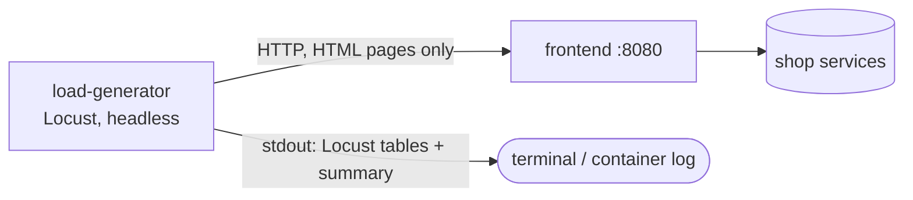
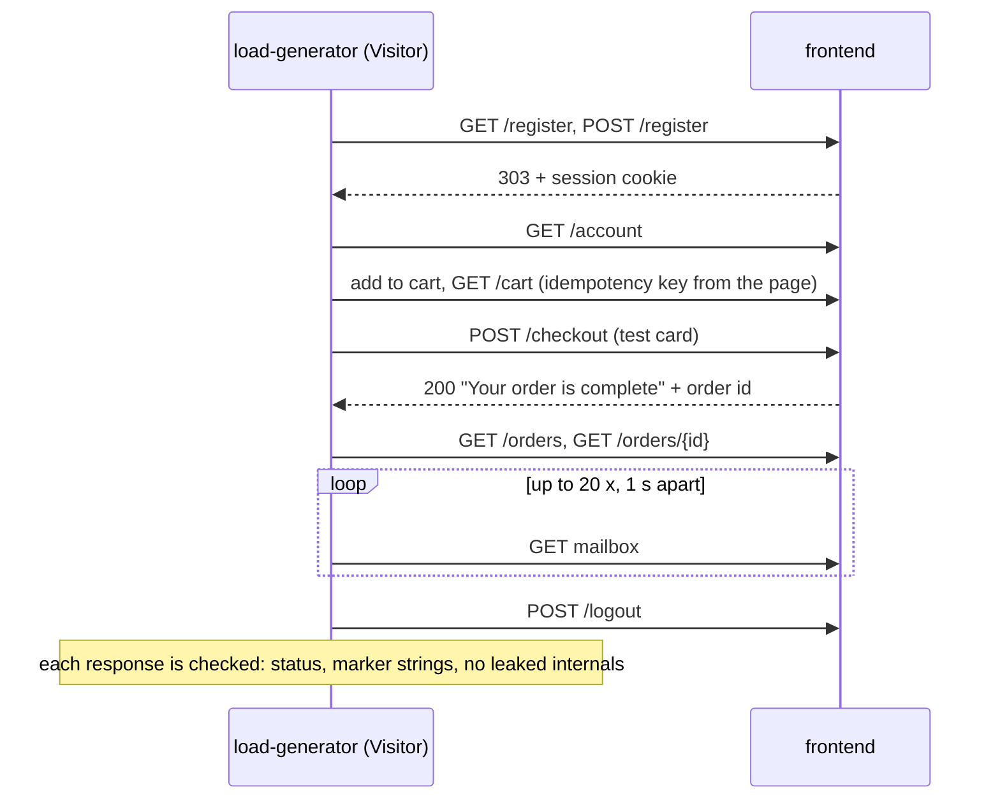

# Architecture

## Context

The load generator talks to the frontend only; the services behind it are reached through the frontend. In the local stack it is started on demand with the compose profile `loadgen` (`local/compose.yaml`).

## Flow of one journey (account journey, abbreviated)

The exact routes are in `src/loadgen/page.py` and `forms.py`; the diagram shows the sequence, not every request.

## Components

| Module | Role |
|---|---|
| `__main__.py` | turns the environment into Locust arguments (`--headless --only-summary --stop-timeout 30`), exit code 2 on bad configuration |
| `config.py` | environment parsing and validation |
| `journeys.py` | the Locust user, weighted tasks, caps, the summary and the `FAIL_RATIO` exit code |
| `client.py` | `Visitor`: request plus status / marker / leak / redirect checks |
| `page.py`, `forms.py` | HTML helpers (pure functions, unit tested) and the form payloads |
| `budget.py` | the `MAX_ORDERS` / `MAX_REVIEWS` counters |

## Cookies

The frontend marks its cookies `Secure`; `python-requests` would not send them back over `http://`, which would turn every request into a new visitor. The client clears the flag on received cookies (`client.py`). An early run of the first version failed 4 of 62 requests because of this; the client was fixed.

## Product choice

The generator only buys products whose page says plainly `In stock` (not `Only N left`, not sold out), so a run does not take the last units of anything. Redirects are never followed automatically; a journey follows only the ones it expects, and only to the same host.
